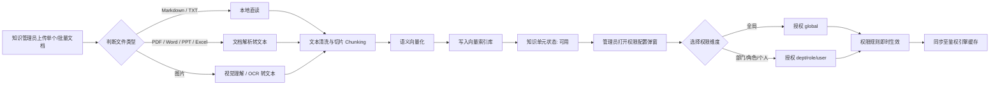
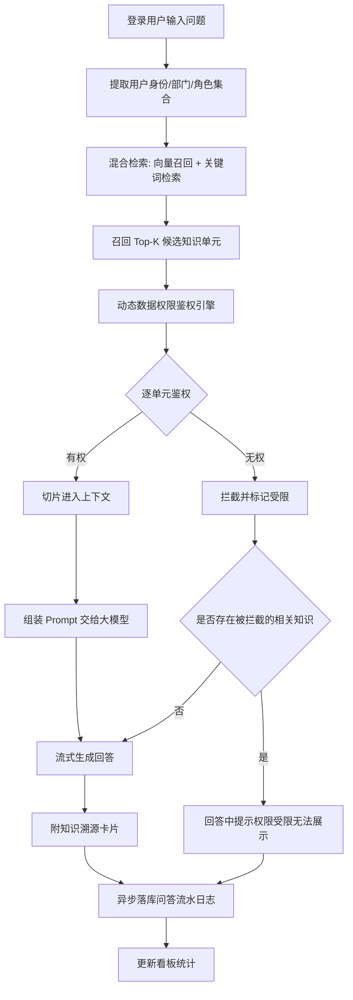
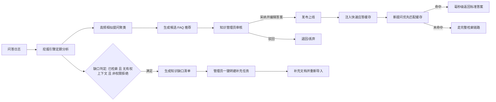
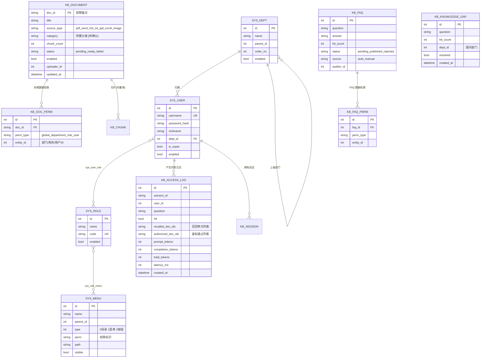

# 知识库管理平台 需求规格说明书（PRD）

> | 文档名称 | 知识库管理平台 需求规格说明书（PRD） |
> |----------|--------------------------------------|
> | 版本 | v0.2 |
> | 作者角色 | 产品经理 |
> | 日期 | 2026-10-16 |
> | 状态 | 草稿（已确认 3 项关键决策，见 §12） |
> | 需求主依据 | `docs/知识库管理平台项目要求.md`（章节 2.9） |
> | 参考基线 | `F:\Download\5_杨涛\5.其他\晋海港_知识库平台`（既有实现「掌柜智库 ZGZK」，仅作可行性佐证与基线参考） |

**修订记录**

| 版本 | 日期 | 修订内容 |
|------|------|---------|
| v0.1 | 2026-10-16 | 首版：基于要求文档生成完整 PRD |
| v0.2 | 2026-10-16 | 关闭 4 项待确认：① 格式范围确定为 7 类（TXT/PPT/Excel/图片一并实现）；② 知识缺口判定口径采用参考实现；③ 鉴权拦截列表不落库（记录为需求偏差）。详见 §12 |

**阅读约定**

- 凡要求文档未明确、参考资料又不构成权威依据的内容，一律标注 `[待确认]`，不做推定与编造。
- 参考资料（既有实现）中已落地的做法，凡本文引用处均标注「参考基线」，它**不构成需求**，仅供方案取舍时参考。
- 本文只描述「要什么」，不规定「怎么实现」；技术选型统一收敛在 §10 依赖与约束。

---

## 1. 产品目标与价值

### 1.1 背景与要解决的问题

企业知识资产散落于产品手册、说明书、规章制度等文档中，当前存在三类问题：

1. **找不到**：文档数量多、格式杂，关键词检索命中率低，员工依赖人工翻找或口头询问。
2. **不可信**：通用大模型回答无出处、易编造，无法作为企业制度与技术依据。
3. **不能分级**：薪酬、财务、内部制度等敏感知识与公开知识混放，缺少细粒度管控，存在越权阅读风险。

### 1.2 建设目标

建设集**知识多源维护、四维细粒度权限鉴权、AI 鉴权检索问答、数据运营看板与知识自动沉淀**于一体的知识库管理平台，形成「文档进来 → 智能问答 → 权限管控 → 运营分析 → 知识沉淀」的完整闭环。

| 编号 | 目标 | 对应价值 |
|------|------|---------|
| G1 | 多格式文档统一入库，自动清洗、切片、向量化 | 知识可被机器理解与检索 |
| G2 | 四维混合数据权限 + AI 检索动态鉴权 | 敏感知识分级可控、越权零泄漏 |
| G3 | 登录态强制的 AI 问答，回答带引用溯源 | 答案可信、可核查 |
| G4 | 运营看板量化使用与成本 | 用量、成本、效果可度量 |
| G5 | FAQ 聚类沉淀 + 知识缺口闭环 | 平台越用越快、越用越准 |

### 1.3 产品边界

**In-Scope（本期内，来自要求文档 §2.9.1）**

- 知识维护与解析：单文档上传、批量文档/文件夹拖拽导入，支持 **PDF、Word、Markdown、TXT、PPT、Excel、图片共 7 类格式**（格式范围已于 §12 决策 D1 确认），自动清洗、分块、向量化索引、知识单元生命周期管理。
- 组织架构与多维权限：用户/角色/部门树维护，菜单与操作功能权限，四维混合数据权限。
- AI 鉴权检索与问答：登录态检索与鉴权过滤、未授权拦截提示、引用溯源卡片、多轮上下文、流式 Markdown 渲染。
- 运营监控与数据看板：访问量（PV/UV）、知识单元总量、高频提问排行、热门知识排行、Token 消耗统计、响应延时分布。
- 知识自进化与沉淀：会话日志高频问题聚类、候选 FAQ 推荐、人工审核发布、FAQ 缓存加速、知识缺口识别。

**Out-of-Scope / 待定（要求文档未提及，需确认）**

| 事项 | 说明 |
|------|------|
| 联网搜索（外部 Web 检索） | 要求文档未提及，参考基线支持并可开关，`[待确认]` 是否纳入 |
| RAG 效果评测（RAGAS 五指标） | 要求文档未提及，参考基线具备，`[待确认]` 是否作为交付项 |
| 多租户 / 跨组织隔离 | 要求文档未提及，`[待确认]` |
| 移动端适配 | 要求文档未提及，`[待确认]` |
| 视频 / 音频类知识解析 | 要求文档未提及，`[待确认]` |

### 1.4 成功标准（可量化）

> 要求文档未给出量化目标，以下目标值均需业务方拍板。

| 编号 | 指标 | 定义 | 目标值 | 备注 |
|------|------|------|--------|------|
| M1 | 知识覆盖率 | 已入库且已配置可访问权限的知识单元占比 | `[待确认]` | 要求文档 §2.9.8 提及「知识库总覆盖率」 |
| M2 | FAQ 缓存直接命中率 | FAQ 缓存命中次数 / 总提问次数 | `[待确认]` | 要求文档 §2.9.8 明确口径 |
| M3 | 越权泄漏事件数 | 未授权知识内容出现在回答中的次数 | **0**（红线） | 要求文档 §2.9.4「严禁越权泄漏」 |
| M4 | 问答响应时长 | 提问到回答完成（或首字，口径 `[待确认]`） | P95 ≤ `[待确认]` ms | |
| M5 | 检索鉴权成功率 | 鉴权引擎正常返回允许/拒绝结果的比例 | `[待确认]` | |
| M6 | 知识缺口闭环率 | 已标记处理的知识缺口 / 累计缺口总数 | `[待确认]` | |
| M7 | 端到端演示通过 | 至少 1 个典型业务场景全流程跑通 | 100% | 要求文档 §2.9.9 硬性要求 |

---

## 2. 用户角色与权限矩阵

### 2.1 角色定义（要求文档 §2.9.2）

| 角色 | 职责描述 | 核心权限 |
|------|---------|---------|
| **普通用户 / 提问者** | 登录系统使用 AI 对话工作台进行智能问答，按被赋予的数据权限获取解答内容 | 登录；使用 AI 问答工作台；查看本人历史会话；对无权知识单元接收友好缺失提示 |
| **知识管理员** | 执行文档导入、编辑、切片调整与删除；配置知识单元四维数据权限；审核发布推荐 FAQ；查看并处理知识缺口清单 | 知识单元 CRUD + 导入 + 切片调整；数据权限配置；FAQ 审核/发布/驳回；知识缺口查看与处理；查看看板 |
| **系统管理员** | 维护组织部门、角色与用户账号；分配功能菜单与按钮操作权限；监控全平台用量看板与模型服务参数 | 部门/角色/用户 CRUD；菜单与按钮权限分配；全平台看板；模型服务参数配置 |

> 补充说明：要求文档未明确三类角色是否互斥（同一账号可否身兼多角色），也未明确是否需要「超级管理员」上位角色，`[待确认]`。

### 2.2 功能操作权限点（建议清单）

要求文档仅给出「增删改查、AI 访问」的粒度描述，未给具体权限点标识。下表为**参考基线**的权限点命名，供评审确认 `[待确认]`：

| 模块 | 权限点（建议） | 说明 |
|------|---------------|------|
| 知识管理 | `knowledge:list` / `query` / `import` / `update` / `delete` / `perm` | perm 为数据权限配置 |
| 组织权限 | `user:*`、`role:*`（含 `role:perm`）、`dept:*` | 含部门树维护 |
| 数据看板 | `dashboard:view` | |
| 知识沉淀 | `faq:list` / `audit` / `delete`、`gap:list` | |
| AI 对话 | `ai:chat` | |

### 2.3 四维数据权限矩阵（要求文档 §2.9.4）

| 权限维度 | 标识 | 命中条件 | 说明 |
|---------|------|---------|------|
| 全局 | `global` | 无条件命中 | 所有登录用户可读 |
| 部门 | `department` | 用户直属部门 ∈ 配置部门集合 | 参考基线仅取用户**直属部门**；上层部门是否自动继承 `[待确认]` |
| 角色 | `role` | 用户所属角色集合 ∩ 配置角色集合 ≠ ∅ | 是否含多级角色继承 `[待确认]` |
| 个人 | `user` | 用户 ID ∈ 配置人员集合 | |

- **判定逻辑**：充分条件（OR）——命中任一维度即放行。
- **默认值**：知识单元默认**无任何公开访问权限**（拒绝优先）。
- **无权限数据**：切片缺失权限锚点（doc_id）时一律拒绝，防止绕过鉴权。
- **FAQ 数据权限**：要求文档未规定，参考基线为「未配置即公开」，与知识单元语义相反，`[待确认]`。

---

## 3. 用户故事

| 编号 | 用户故事 | 对应需求 |
|------|---------|---------|
| US-01 | 作为**知识管理员**，我希望把 PDF、Word、Markdown、TXT、PPT、Excel、图片等多格式文档拖进系统就能自动完成清洗、切片与向量化入库，以便不必手工整理格式。 | FR-02/03/04/05/06 |
| US-02 | 作为**知识管理员**，我希望在导入过程中看到每个文件的处理进度（解析 → 切片 → 向量化 → 入库），以便判断是否需要干预。 | FR-07 |
| US-03 | 作为**知识管理员**，我希望在知识单元台账上看到编号、标题、格式、分类、权限标签、更新时间与启用状态，以便统一管理知识资产。 | FR-01 |
| US-04 | 作为**知识管理员**，我希望为一个知识单元一次性勾选「全局/部门/角色/个人」四类授权对象，以便一份敏感制度只对特定人群开放。 | FR-17 |
| US-05 | 作为**系统管理员**，我希望维护部门树、用户账号与角色，并按角色勾选菜单与按钮权限，以便控制谁能用什么功能。 | FR-13/14/15/16 |
| US-06 | 作为**普通用户**，我希望登录后直接用自然语言提问并得到流式输出的答案，以便快速解决业务咨询。 | FR-21/27 |
| US-07 | 作为**普通用户**，我希望答案下方附上引用来源卡片，以便核对答案依据、判断可信度。 | FR-28 |
| US-08 | 作为**普通用户**，我希望当相关知识存在但我无权查看时，系统明确告知「因权限受限无法展示」而不是给出错误答案或暴露内容，以便我理解边界并知道如何申请。 | FR-24/25 |
| US-09 | 作为**普通用户**，我希望能在多轮对话中追问、并随时回看历史会话，以便连续完成一次业务咨询。 | FR-21/29 |
| US-10 | 作为**普通用户**，我希望系统推荐常见问题，以便我不知道如何提问时也能快速得到答案。 | FR-30 |
| US-11 | 作为**知识管理员**，我希望系统自动聚类高频提问并给出候选 FAQ 与聚合频次，以便把重复劳动沉淀为标准答案。 | FR-43/44/45 |
| US-12 | 作为**知识管理员**，我希望在线修正答案后发布或驳回候选 FAQ，发布后同类提问直接命中缓存秒回。 | FR-46/47 |
| US-13 | 作为**知识管理员**，我希望看到「问了但知识库没有」的问题清单及其频次，并一键转建补充任务，以便指导后续知识建设。 | FR-50/51/52 |
| US-14 | 作为**系统管理员**，我希望在看板上看到访问量、活跃人数、Token 消耗、响应延时与热门排行，以便掌握平台使用情况与成本。 | FR-33~38 |
| US-15 | 作为**系统管理员**，我希望配置底层模型服务参数，以便适配企业已有的大模型资源。 | FR-54 |
| US-16 | 作为**审计/合规角色**（`[待确认]` 是否存在该角色），我希望检索每次问答的召回与鉴权通过记录，以便事后追溯与合规审计。 | FR-40/41 |

---

## 4. 功能需求清单（需求池）

> 优先级：**P0** 必须 / **P1** 重要 / **P2** 可选。P0 须 100% 覆盖主流程。

### 4.1 知识维护与解析（KM）

| 编号 | 模块 | 功能 | 优先级 | 说明 |
|------|------|------|--------|------|
| FR-01 | 知识维护 | 知识单元台账列表 | P0 | 字段：编号、标题、格式、所属分类、权限标签、更新时间、启用状态；支持关键词与状态筛选、分页 |
| FR-02 | 知识维护 | 单文档上传 | P0 | 上传后异步解析入库 |
| FR-03 | 知识维护 | 批量文档/文件夹拖拽导入 | P0 | 支持一次多选；「文件夹」是否递归上传 `[待确认]` |
| FR-04 | 知识维护 | 多格式文档解析与清洗 | P0 | 覆盖 **PDF、Word、Markdown、TXT、PPT、Excel、图片 共 7 类**（决策 D1）；TXT/Markdown 可本地直读，其余经解析转换；**图片类文档须先经视觉理解/OCR 转为可检索文本**，否则无法被检索命中；解析失败需可感知并可重试 |
| FR-05 | 知识维护 | 自动文本分块（Chunking） | P0 | 分块策略与参数可配置 `[待确认]`；表格类内容（Excel/PPT/文档内表格）需线性化以保证语义完整 |
| FR-06 | 知识维护 | 语义向量化与索引入库 | P0 | 切片需携带知识单元锚点，供后续鉴权使用 |
| FR-07 | 知识维护 | 导入进度可视化 | P0 | 逐文件展示阶段进度与失败原因 |
| FR-08 | 知识维护 | 知识单元编辑 | P1 | 标题/备注等元数据编辑；是否可改分类 `[待确认]` |
| FR-09 | 知识维护 | 知识单元删除与级联清理 | P0 | 删除需连带清理向量、切片、权限等关联数据，不留残余 |
| FR-10 | 知识维护 | 切片查看与调整 | P1 | 形态待定：查看切片列表/调整边界/编辑切片内容 `[待确认]` |
| FR-11 | 知识维护 | 知识单元启用/禁用 | P1 | 「启用状态」台账字段的落地形态 |
| FR-12 | 知识维护 | 重新解析/重新索引 | P2 | 文档更新后的重建能力，`[待确认]` 是否纳入 |

### 4.2 组织架构与权限（ORG）

| 编号 | 模块 | 功能 | 优先级 | 说明 |
|------|------|------|--------|------|
| FR-13 | 组织权限 | 部门树形结构维护 | P0 | 增删改查；层级上限 `[待确认]` |
| FR-14 | 组织权限 | 用户管理 | P0 | 账号增删改查、启用/禁用、归属部门、分配角色 |
| FR-15 | 组织权限 | 角色管理 | P0 | 角色增删改查、启用/禁用 |
| FR-16 | 组织权限 | 菜单与按钮操作权限分配 | P0 | 以权限树勾选方式分配；细到「增删改查、AI 访问」 |
| FR-17 | 组织权限 | 四维数据权限配置 | P0 | 权限实体选择器：全局开关+部门树多选+角色多选+人员多选；覆盖式保存 |
| FR-18 | 组织权限 | 批量设置数据权限 | P1 | 参考基线支持列表多选后批量赋权，要求文档未明确 `[待确认]` |
| FR-19 | 组织权限 | 登录认证与登录态 | P0 | 登录/登出/当前用户信息；认证方式 `[待确认]`（自建账号 or SSO/LDAP） |
| FR-20 | 组织权限 | 前端按钮级鉴权与路由守卫 | P0 | 无权菜单不展示、无权路由拦截跳转 |

### 4.3 AI 鉴权检索与问答（AI）

| 编号 | 模块 | 功能 | 优先级 | 说明 |
|------|------|------|--------|------|
| FR-21 | AI 问答 | 多轮对话工作台 | P0 | 消息列表、输入框、多轮上下文管理 |
| FR-22 | AI 问答 | 对话强制登录校验 | P0 | 未登录不得调用问答 |
| FR-23 | AI 问答 | 混合检索（向量+关键词）召回 | P0 | Top-K 与融合策略参数 `[待确认]` |
| FR-24 | AI 问答 | 检索结果数据权限鉴权过滤 | P0 | **核心**：输出允许/拦截两组结果；鉴权须覆盖**召回后的全部候选切片** |
| FR-25 | AI 问答 | 未授权拦截与安全提示 | P0 | 文案：要求文档「部分参考资料因权限受限无法展示」；参考基线为另一版本，`[待确认]` |
| FR-26 | AI 问答 | 仅用有权切片组装上下文 | P0 | 越权内容严禁进入 Prompt |
| FR-27 | AI 问答 | 流式 Markdown 渲染输出 | P0 | 打字机输出、代码高亮、表格渲染 |
| FR-28 | AI 问答 | 知识引用溯源卡片 | P0 | 悬浮/折叠展示引用来源（标题、切片摘录、定位） |
| FR-29 | AI 问答 | 历史会话侧边栏 | P1 | 新建/切换/删除会话；可见范围 `[待确认]` |
| FR-30 | AI 问答 | 智能联想提问 | P1 | 参考基线为「常见问题快捷点击」；输入联想实现口径 `[待确认]` |
| FR-31 | AI 问答 | 生成中断/重新提问 | P2 | 参考基线具备，要求文档未明确 |
| FR-32 | AI 问答 | 联网搜索开关 | P2 | 要求文档未提及，需确认是否纳入 `[待确认]` |

### 4.4 运营监控与数据看板（OPS）

| 编号 | 模块 | 功能 | 优先级 | 说明 |
|------|------|------|--------|------|
| FR-33 | 看板 | 访问量 PV/UV | P0 | 访问次数、独立访问人数 |
| FR-34 | 看板 | 知识单元总量 | P0 | |
| FR-35 | 看板 | 高频提问排行 TOP N | P0 | 排序口径与是否剔除 FAQ 命中 `[待确认]` |
| FR-36 | 看板 | 热门知识单元排行 TOP N | P0 | 按被引用/被命中次数 |
| FR-37 | 看板 | Token 消耗统计与趋势 | P0 | 统计口径 `[待确认]`（是否含视觉理解/向量化消耗） |
| FR-38 | 看板 | 系统响应延时分布 | P0 | 形态 `[待确认]`：均值/分位数/分桶直方图 |
| FR-39 | 看板 | 访问趋势图 | P1 | 参考基线为近 14 天折线，要求文档未明确周期 |
| FR-40 | 看板 | 问答审计流水记录 | P1 | 记录：会话 ID、用户 ID、时间、提问文本、**召回单元列表、鉴权通过列表**、Token、耗时。⚠️ 要求文档 §2.9.8 另要求「鉴权拦截列表」，经决策 D3 **不落库**（需求偏差，见 §12） |
| FR-41 | 看板 | 审计记录查询与导出 | P2 | `[待确认]` 是否纳入 |
| FR-42 | 看板 | 运营效能指标摘要 | P1 | 当日/周总提问量、UV、FAQ 缓存命中率、知识库覆盖率、平均问答延时 |

### 4.5 知识沉淀与自进化（PRE）

| 编号 | 模块 | 功能 | 优先级 | 说明 |
|------|------|------|--------|------|
| FR-43 | 沉淀 | 会话日志语义去重与频次聚合 | P0 | 聚类而非纯字符串计数 `[待确认]` |
| FR-44 | 沉淀 | 候选 FAQ 自动推荐 | P0 | 达阈值自动生成；阈值默认值 `[待确认]`（参考基线为 5 次） |
| FR-45 | 沉淀 | 候选 FAQ 卡片信息 | P0 | 聚类问题簇、聚合频次、关联知识单元、推荐标准答案、置信度得分 |
| FR-46 | 沉淀 | FAQ 人工审核（采纳编辑/发布/驳回） | P0 | 在线修正标准答案后发布 |
| FR-47 | 沉淀 | FAQ 发布与缓存生效 | P0 | 发布即写入缓存，命中时毫秒级直接返回，跳过检索与生成 |
| FR-48 | 沉淀 | 已发布 FAQ 管理与检索 | P1 | 支持缓存生效控制与快速检索 |
| FR-49 | 沉淀 | FAQ 数据权限配置 | P1 | 默认语义 `[待确认]`（要求文档未规定） |
| FR-50 | 沉淀 | 知识缺口识别 | P0 | **判定口径按决策 D2 采用参考实现方案**：满足「确实执行过检索」+「无任何有权上下文」+「非权限拒绝」三个条件才判定为知识缺口；**不引入相似度阈值判定**。可据此排除两类误判：①因表述不清/需澄清而未真正检索；②知识存在但用户无权访问 |
| FR-51 | 沉淀 | 知识缺口清单 | P0 | 字段：未命中提问文本、提问部门、近期频次、时间戳；「最高相似度得分」「建议创建分类」为要求文档 §2.9.8 列明字段，**不参与缺口判定**，是否仍展示 `[待确认]` |
| FR-52 | 沉淀 | 一键转建知识补充任务 | P0 | 要求文档明确要求，参考基线仅有「标记已解决」，需新建任务实体 `[待确认]` 形态 |
| FR-53 | 沉淀 | 缺口标记已解决 | P1 | |

### 4.6 系统配置（SYS）

| 编号 | 模块 | 功能 | 优先级 | 说明 |
|------|------|------|--------|------|
| FR-54 | 系统 | 底层模型接口配置 | P1 | 模型地址、密钥、模型名、生成参数；具体配置项 `[待确认]` |
| FR-55 | 系统 | 检索与沉淀参数配置 | P2 | 召回 Top-K、FAQ 阈值等可调项 |

---

## 5. 非功能需求（量化）

> 要求文档未给出任何量化指标，下表数值除明确标注外均为 `[待确认]`。

| 类别 | 要求 | 指标 |
|------|------|------|
| 性能 | 问答首字延迟（流式） | P95 ≤ `[待确认]` ms |
| 性能 | 问答端到端响应时长 | P95 ≤ `[待确认]` ms |
| 性能 | FAQ 缓存命中响应 | 毫秒级（要求文档 §2.9.4 明文要求），目标 ≤ `[待确认]` ms |
| 性能 | 数据权限鉴权单次耗时 | ≤ `[待确认]` ms |
| 性能 | 单文件导入处理时长 | 依文件类型与大小分档 `[待确认]`；**图片/PPT/Excel 类因需视觉理解，耗时预期显著高于纯文本类** |
| 性能 | 台账/看板列表接口 | P95 ≤ `[待确认]` ms |
| 安全 | 鉴权覆盖率 | **100%**——进入 AI 上下文的每个切片均须通过数据权限校验，无锚点切片一律拒绝 |
| 安全 | 越权泄漏 | **0 次**（红线，§2.9.4「严禁越权泄漏未授权内容」） |
| 安全 | 认证 | 登录态强制；密码加盐不可逆存储；会话凭证需有有效期与失效机制；具体方案 `[待确认]` |
| 安全 | 传输与存储 | `[待确认]`：是否强制 HTTPS、敏感字段加密、密钥管理方式 |
| 安全 | 审计 | 问答留痕（用户、时间、召回、鉴权通过、Token、耗时）；**鉴权拦截明细不落库**（决策 D3），留存时长 `[待确认]` |
| 合规 | 等级保护/数据分级 | `[待确认]`：是否需等保测评、是否允许调用外部云模型 API |
| 可用性 | SLA | `[待确认]`（如 99.9%） |
| 可用性 | 降级策略 | 检索或鉴权异常时须**安全降级为拒绝**；模型不可用时给出可读错误而非静默失败 |
| 并发 | 峰值并发提问数 | `[待确认]` |
| 并发 | 峰值并发导入数 | `[待确认]` |
| 规模 | 知识单元总量/切片总量 | `[待确认]` |
| 规模 | 单文件大小上限 | `[待确认]` |
| 兼容性 | 浏览器 | Chrome/Edge 最近两个大版本；移动端适配 `[待确认]` |
| 可观测性 | 日志与监控 | 问答链路埋点、失败可定位；告警方式 `[待确认]` |
| 可维护性 | 参数可配置 | 检索、切分、FAQ 阈值、模型参数等不得硬编码，须可配置化 |

---

## 6. 核心业务流程图

### 6.1 知识维护与权限配置流程（要求文档 §2.9.7）



### 6.2 AI 鉴权检索与问答流程（要求文档 §2.9.7）



### 6.3 知识沉淀与 FAQ 运营闭环（要求文档 §2.9.7）



---

## 7. 关键页面原型说明

### 7.1 知识维护与导入中心

```
┌──────────────────────────────────────────────────────────────────┐
│ 知识单元台账                                                       │
├──────────────────────────────────────────────────────────────────┤
│ [关键词搜索] [格式▾] [分类▾] [状态▾] [查询]  [导入文档] [批量设权限]│
├──────────────────────────────────────────────────────────────────┤
│ ☐ 编号   标题        格式   分类   权限标签      更新时间   状态  操作│
│ ☐ KB001 差旅报销标准 PDF   财务   全局可见        2026-10-01 启用  │
│ ☐ KB002 高管薪酬细则 Word   人力   部门×1 角色×2  2026-10-02 启用  │
│ ☐ KB003 设备面板图   IMG   技术   未分配(红)     2026-10-03 处理中│
│                          [数据权限] [编辑] [切片] [删除]           │
├──────────────────────────────────────────────────────────────────┤
│                                          分页: 共 N 条  < 1 2 3 > │
└──────────────────────────────────────────────────────────────────┘

① 导入抽屉（拖拽区 + 进度）
┌────────────────────────────────────────────┐
│  将文件拖到此处，或 点击选择                │
│  支持格式: PDF / Word / Markdown / TXT /    │
│           PPT / Excel / 图片                │
├────────────────────────────────────────────┤
│  处理进度（解析 → 切片 → 向量化 → 入库）     │
│  ✓ 差旅报销标准.pdf    ✓解析 ✓切片 ⌛向量化 │
│  ✓ 设备面板图.png      ✓图片理解 ✓切片      │
│  ✗ 说明文档.pptx       失败: 解析超时 [重试] │
└────────────────────────────────────────────┘

② 四维数据权限分配弹窗
┌────────────────────────────────────────────┐
│  数据权限分配 —— 目标：KB002（或已选 N 项）  │
│  ◆ 全局可见  [关]  开启后忽略下方设置        │
│  部门   [部门树 ▾ 多选 ☑财务部 ☑人事部]      │
│  角色   [多选 ▾  ☑管理层 ☑HRBP]             │
│  个人   [搜索用户 ▾ 多选 张XX / 李XX]        │
│  提示：默认无任何权限，命中任一维度即可访问   │
│                     [取消]  [保存]           │
└────────────────────────────────────────────┘
```

### 7.2 AI 智能问答工作台

```
┌──────────────┬───────────────────────────────────────────────────┐
│ [+ 新建对话] │  当前会话标题                        [清空当前对话]│
│              ├───────────────────────────────────────────────────┤
│ 历史会话     │                                                   │
│  > 差旅报销  │  🧑 出差住宿标准是多少？                          │
│  > 设备维修  │                                                   │
│              │  🤖 ✓检索知识库 ✓权限校验 ⏳生成中…               │
│ 常见问题     │  ┌───────────────────────────────────────────┐   │
│  · 报销流程  │  │ 根据《差旅报销标准》…（流式 Markdown 渲染）│   │
│  · 保修政策  │  │ 代码块 / 表格等                            │   │
│  · 入职材料  │  └───────────────────────────────────────────┘   │
│              │  📎 引用来源 ①《差旅报销标准》P3 ②《费用管理规定》│
│              │  ⚠️ 检测到相关制度文档，但您当前所属部门/角色    │
│              │     无权查阅该内容                                │
│              ├───────────────────────────────────────────────────┤
│              │ [输入问题…                        ] 0/1000       │
│              │                        [发送] / [停止]           │
└──────────────┴───────────────────────────────────────────────────┘
```

### 7.3 知识沉淀与运营管理页

```
FAQ 挖掘与审核发布区 / 已发布 FAQ 区 / 知识缺口清单区  （三区 Tab 切换）

┌─ Tab: FAQ 审核 ──────────────────────────────────────────────────┐
│ (全部) (待审核) (已发布) (已驳回)                                 │
│ 问题                        聚合频次  关联知识     置信度  状态    │
│ 生鲜破损如何申请退款          52      《售后政策》  0.93  待审核  │
│                                        [审核] [数据权限] [驳回]   │
└──────────────────────────────────────────────────────────────────┘
  FAQ 审核弹窗：问题（只读）/ 标准答案（可编辑 textarea）/ [驳回] [发布上线]

┌─ Tab: 已发布 FAQ ────────────────────────────────────────────────┐
│  问题 | 答案 | 命中次数 | 缓存生效[开/关] | 数据权限 | 操作        │
└──────────────────────────────────────────────────────────────────┘

┌─ Tab: 知识缺口 ──────────────────────────────────────────────────┐
│ 未命中的问题              提问部门  近期频次  时间戳               │
│ 海外直邮保税仓清关延误     客服部     17      2026-10-12          │
│                              [一键转建补充任务] [标记已解决]       │
│ 说明：缺口判定不依赖相似度阈值（决策 D2）                          │
└──────────────────────────────────────────────────────────────────┘
```

### 7.4 运营看板与数据大盘

```
┌────────┬────────┬────────┬────────┬────────┬────────┐
│访问次数│访问人数│知识单元│Token消耗│平均延时│缓存命中率│
│ 1,234  │  56    │  128   │ 1.2M   │ 2,340ms│  18%   │
└────────┴────────┴────────┴────────┴────────┴────────┘
┌───────────────────────────────┬───────────────────────┐
│  访问趋势（PV / UV 折线图）    │  热门知识单元 TOP10    │
│                               │  （环形/条形图）       │
├───────────────────────────────┴───────────────────────┤
│  常见高频问题 TOP10（表格：排名 | 问题 | 提问次数）      │
├────────────────────────────────────────────────────────┤
│  Token 消耗趋势图 / 响应时长分布图                       │
└────────────────────────────────────────────────────────┘
```

### 7.5 组织架构与系统配置页

```
部门管理：树形结构（增删改）+ 部门详情
用户管理：列表（账号/昵称/部门/角色/状态）+ 新增/编辑/启用禁用/重置密码
角色管理：列表 + 权限分配树
      ┌──────────────────────────────┐
      │ ☑ 知识管理                    │
      │   ☑ 知识单元  ☑查询 ☑导入     │
      │              ☑编辑 ☑删除 ☑权限│
      │ ☑ AI 对话  ☑ 访问             │
      │ ☑ 数据看板 ☑ 查看             │
      └──────────────────────────────┘
系统配置：模型接口配置（地址 / 密钥 / 模型名 / 参数）、检索与沉淀参数
```

---

## 8. 数据实体初稿（ER）



**实体补充说明**

- `KB_CHUNK`（切片）：切片 ID、正文、所属 `doc_id`（权限锚点，冗余存储）、标题、分类。**无 `doc_id` 的切片一律拒绝访问**。图片类文档产生的切片来源于视觉理解文本，可与原图建立关联。
- `KB_SESSION`（会话与消息）：会话 ID、用户 ID、标题、消息列表、创建时间；存储介质 `[待确认]`。
- `KB_ACCESS_LOG`：按决策 D3 **不记录鉴权拦截明细**（需求偏差，见 §12）。
- `KB_KNOWLEDGE_GAP`：按决策 D2，判定不依赖相似度，「最高相似度得分」「建议创建分类」是否保留为展示字段 `[待确认]`。
- 权限实体 `perm_type` 的「部门」取值，要求文档写作 `department`，参考基线写作 `dept`，**标识命名需统一** `[待确认]`。

---

## 9. 验收标准（AC）

| 编号 | 验收条件（前置 — 操作 — 预期） | 覆盖 |
|------|------------------------------|------|
| AC-01 | 给定系统管理员账号，当我登录后维护部门树、创建角色并勾选菜单/按钮权限，则权限树保存成功且新用户登录后仅能看到被授权的菜单与按钮 | FR-13~16、FR-20 |
| AC-02 | 给定知识管理员账号，当我分别上传 PDF、Word、Markdown、TXT、PPT、Excel、图片各一份并执行批量导入，则全部文件完成解析切片并成功入库、台账可见且状态为「可用」；**其中图片文档的内容可被文本提问检索命中** | FR-02/03/04/05/06 |
| AC-03 | 给定导入中的文档，当我查看导入进度，则能看到「解析 → 切片 → 向量化 → 入库」各阶段状态，失败文件能看到原因并可重试 | FR-07 |
| AC-04 | 给定一个知识单元，当我执行增删改查并为其混合配置全局、部门、角色、个人四类权限，则配置保存成功、台账权限标签正确显示、且配置即时生效无需重启 | FR-01/08/09/17 |
| AC-05 | 给定某知识单元仅授权给 A 部门与 B 角色，当 A 部门用户、B 角色用户、超管分别提问命中该知识，则三者回答均包含该知识内容；当 C 部门且无 B 角色的用户提问，则该内容不进入回答 | FR-24/26 |
| AC-06 | 给定存在相关知识但当前用户无权访问，当该用户提问，则回答中明确输出「部分参考资料因权限受限无法展示」类提示 `[文案待确认]`，且正文与引用卡片中**不出现**任何未授权内容 | FR-25 |
| AC-07 | 给定未登录状态，当我直接访问问答接口或页面，则请求被拒绝/跳转登录页 | FR-22 |
| AC-08 | 给定已积累若干天问答日志，当我打开数据看板，则正确展示访问次数、独立人数、知识单元数、常见问题榜、知识热度榜、Token 消耗与响应时间趋势 | FR-33~38 |
| AC-09 | 给定同一问题被提问次数达到阈值，当挖掘任务运行后，则生成候选 FAQ（含聚合频次与置信度），管理员审核发布后，后续相同提问毫秒级命中缓存并直接返回标准答案 | FR-43~47 |
| AC-10 | 给定一个知识库中不存在答案的问题被多次提问，当挖掘任务运行后，则知识缺口清单中出现该问题及其提问频次，并可一键转建补充任务 | FR-50~52 |
| AC-11 | 给定一次提问因表述不清/需澄清而未真正执行检索，或相关知识存在但用户无权访问，则该次提问**不得**被计入知识缺口（决策 D2 口径） | FR-50 |
| AC-12 | 给定要求文档 §2.9.9 中任一业务场景，从导入 → 配权限 → 提问 → 鉴权 → 沉淀，可完成端到端全流程演示 | 全流程 |
| AC-13 | 给定删除一个知识单元，则其向量、切片与权限配置被同步清理，检索不再命中残留数据 | FR-09 |
| AC-14 | 给定模型服务或检索服务异常，则系统安全降级（拒绝未授权内容、给出可读错误提示），不得静默放行或返回越权内容 | NFR-安全 |

---

## 10. 依赖与约束

### 10.1 外部依赖

| 依赖项 | 用途 | 是否可控 | 备注 |
|--------|------|---------|------|
| 大模型服务（LLM） | 答案生成、问题改写 | `[待确认]` | 云 API 或私有化部署待定；涉及数据合规 |
| 视觉模型（VLM）/ OCR | **图片类文档内容理解与语义化**（格式范围含图片，决策 D1） | **必需** | 无此能力图片知识将不可检索 |
| 文档解析能力 | PDF、Word、PPT、Excel 转文本 | **必需** | 云端解析服务 vs 本地解析库 |
| 嵌入模型 | 语义向量化 | `[待确认]` | 中文语义效果关键 |
| 向量检索库 | 切片向量存储与检索 | 可控 | 部署形态待定 |
| 关系数据库 | 用户/权限/知识元数据/看板 | 可控 | |
| 对象存储 | 原始文件与图片 | 必需 | |
| 企业身份源 | 组织架构与账号 | `[待确认]` | 是否对接 SSO/LDAP/企微钉钉 |

> 参考基线采用的组合为：通义千问（LLM/VLM）+ 本地 BGE-M3 与 BGE-reranker + MinerU 云解析 + Milvus/MySQL/MongoDB/MinIO，仅供选型参考，**不构成需求**。注意参考基线的解析链路**不支持 TXT**，本项目需补齐。

### 10.2 约束

1. **技术栈**：要求文档未规定，`[待确认]` 是否沿用参考基线（Vue3 + Element Plus 前端、Python 后端 + LangGraph 工作流）。
2. **算力**：图片/PPT/Excel 解析与视觉理解会显著增加算力与耗时，需评估并发能力 `[待确认]`；本地部署嵌入与重排模型时，单 GPU 下导入与查询推理会相互排队。
3. **密钥与配置**：模型密钥、解析服务 Token、认证密钥等须通过配置注入，不得硬编码或入库。
4. **部署形态**：内网私有化部署（参考基线为单应用端口 + 容器化依赖服务），`[待确认]`。
5. **数据合规**：若调用外部云模型或云解析服务，需确认企业文档出境与保密要求 `[待确认]`。
6. **演示交付**：至少 1 个典型业务场景的端到端演示（§2.9.9 硬性要求）。
7. **测试数据集**：要求文档要求提供「示例知识库测试数据集」，来源与规模 `[待确认]`；参考基线中的设备手册与问答集（含图片类素材）可作参考。

---

## 11. 待确认问题（Open Questions）

> 原 Q1、Q6、Q7、Q13 已于 v0.2 确认关闭，见 §12。

| 编号 | 问题 | 影响 | 建议确认方 |
|------|------|------|-----------|
| Q2 | 「文件夹拖拽导入」是否必须支持目录递归上传？ | 前端交互与后端接口设计 | 业务方 |
| Q3 | 台账字段「所属分类」的定义：业务分类体系（可维护分类树）还是「商品/产品名」式实体？ | 数据模型与检索策略 | 业务方 |
| Q4 | 「切片调整」的具体形态：查看切片/调整切分边界/直接编辑切片内容？ | 知识与开发工作量 | 业务方 |
| Q5 | 未授权提示的最终文案：要求文档版本还是参考基线版本？二者场景不同（部分受限 vs 全部受限） | 交互细节 | 业务方 |
| Q8 | FAQ 数据权限默认语义：未配置时「公开可见」还是「默认拒绝」？ | 缓存命中与越权风险 | 业务方 |
| Q9 | 「一键转建知识补充任务」的落地形态：是否需任务实体与流转（指派、状态机、截止时间）？ | 新增模块工作量 | 业务方 |
| Q10 | 看板「响应延时分布」形态：均值/P50-P95-P99/分桶直方图？ | 埋点粒度与图表实现 | 业务方 |
| Q11 | 「高频提问排行」是否剔除已命中 FAQ 缓存的提问？ | 统计口径准确性 | 业务方 |
| Q12 | 「响应延时」与「Token 消耗」统计口径（起止点、是否含图片理解与向量化消耗） | 看板数据可信度 | 业务方/研发 |
| Q14 | 是否需独立的「审计/合规」角色？三类角色是否为最终清单？ | 角色权限矩阵 | 业务方 |
| Q15 | 「智能联想提问」口径：热门问题快捷推荐还是输入框实时补全？ | 交互实现 | 业务方 |
| Q16 | 历史会话可见范围：仅本人，还是管理员可查看全部？ | 隐私与权限设计 | 业务方/合规 |
| Q17 | 认证方式：自建账号密码还是对接 SSO/LDAP/企微？ | 登录模块与组织同步 | 业务方/IT |
| Q18 | 是否纳入联网搜索能力（要求文档未提，参考基线支持）？ | 功能范围与合规风险 | 业务方 |
| Q19 | 是否将 RAG 效果评测（RAGAS 等）作为交付验收项？ | 交付范围与质量门槛 | 需求提出方 |
| Q20 | 全部非功能指标（并发、SLA、响应时长、知识库规模、单文件上限）的取值 | 架构选型与验收标准 | 业务方/研发 |
| Q21 | 部署形态与算力规格：内网单机/集群、是否具备 GPU、模型云调或本地部署 | 架构与成本 | IT/业务方 |
| Q22 | 交付时间窗、演示形式（现场/视频）、验收环境 | 项目计划 | 需求提出方 |
| Q23 | 知识缺口清单是否仍展示「最高相似度得分」「建议创建分类」字段？（判定已不依赖，展示需额外计算） | 缺口页字段与实现成本 | 业务方 |

---

## 12. 已确认决策记录（Decision Log）

| 编号 | 决策事项 | 结论 | 影响范围 | 与要求文档的关系 |
|------|---------|------|---------|----------------|
| **D1** | 支持的文档格式范围 | **7 类全实现**：PDF、Word、Markdown、TXT、PPT、Excel、图片 | FR-02/03/04/05/06；§7.1 导入原型；§8 `KB_DOCUMENT.source_type`；§10.1 新增 VLM/OCR 与解析能力依赖；§5 导入性能分档 | **扩展**：要求文档仅列 4 类（PDF/MD/Word/TXT），本决策额外纳入 PPT、Excel、图片；参考基线含 PPT/Excel/图片但缺 TXT，需补齐 |
| **D2** | 知识缺口判定口径 | **采用参考实现口径**：需同时满足「确实执行过检索」+「无任何有权上下文」+「非权限拒绝」；**不引入相似度阈值判定** | FR-50/51；AC-11；§6.3 流程；§8 `KB_KNOWLEDGE_GAP` | **偏离**：要求文档 §2.9.4 表述为「检索相似度低于置信度阈值或未命中任何知识切片」；本决策改以「是否真正检索 + 是否有有权上下文」判定，可排除「表述不清」与「无权访问」两类误判 |
| **D3** | 单次问答审计是否落库「鉴权拦截列表」 | **不落库** | FR-40；§5 安全-审计；§8 `KB_ACCESS_LOG` 不含拦截明细 | **偏差（已知并接受）**：要求文档 §2.9.8 明确要求审计记录包含「鉴权拦截列表」。本决策不实现该字段。⚠️ 该字段是权限体系审计能力的关键证据，若后续出现越权争议将无明细可追溯，建议在验收前与需求提出方书面确认此处偏离 |

**决策衍生影响提示**

- D1 使图片知识进入检索链路，**「图片内容可被文本提问命中」应作为验收项**（已落入 AC-02）。
- D2 使「最高相似度得分」失去判定作用，是否保留展示需业务方确认（Q23）。
- D3 与要求文档存在显性冲突，已在 FR-40 与本节双侧标注，避免后续验收争议。

---

## 附录 A：参考资料基线参数（非需求，仅供选型参考）

| 类别 | 参考做法 |
|------|---------|
| 检索 | 混合检索（向量 + 关键词），召回 Top-K = 5；多路召回融合后取 Top 10 |
| 重排 | 重排后在 6–20 条区间做「断崖截断」（相邻分差 ≥ 0.5 或相对差 ≥ 0.25 处截断） |
| 上下文预算 | 生成上下文上限 12000 字符 |
| 切片 | 按 Markdown 标题 1–6 级切分；单段超 500 字符再切；短段 < 200 字符合并；表格线性化 |
| FAQ 推荐阈值 | 同一问题累计命中 ≥ 5 次自动生成待审 FAQ（可配置） |
| FAQ 缓存 | 问题字符串精确匹配（去空格、截断 512 字符）+ 数据权限校验 |
| 知识缺口 | 「真正检索过 + 无任何有权上下文 + 非权限拒绝」才算缺口（已采纳为决策 D2） |
| 鉴权时机 | 召回融合之后、重排之前执行数据权限过滤；无锚点切片一律拒绝 |
| 权限模型 | 操作权限（角色绑定菜单/按钮）与数据权限（文档 × 四维实体）两套正交体系 |
| 检索增强 | 支持假设文档检索（HyDE）、联网搜索（可开关） |
| 文档解析 | 云端解析服务将 PDF/Word/PPT/Excel/图片 统一转为 Markdown；Markdown 走本地直读 |
| 部署 | 单应用端口对外，依赖服务容器化（向量库 + 关系库 + 文档库 + 对象存储） |

## 附录 B：质量自检（Quality Gate）

| 检查项 | 结论 |
|--------|------|
| 目标可量化 | 通过——§1.4 每条目标均给出指标定义；目标值缺失处已标 `[待确认]`，未编造 |
| 角色无遗漏 | 通过——§2 覆盖三类角色，并标注「审计角色」待确认 |
| 用户故事可映射 | 通过——US-01~US-16 均标注对应 FR 编号 |
| 需求池有优先级 | 通过——FR-01~FR-55，P0 覆盖五大主流程 |
| 非功能已量化 | 部分——安全与鉴权类已定量（100% / 0 次），性能与规模类因需求方未提供数值，全部标注 `[待确认]` |
| 流程图自洽 | 通过——§6 三张流程图节点均可映射到 §4 功能编号；流程已同步决策 D1/D2 |
| 验收可测 | 通过——AC-01~AC-14 均可被 QA 验证 |
| 无臆造事实 | 通过——业务事实全部来自要求文档；参考资料内容均显式标注为「参考基线」 |
| 决策可追溯 | 通过——§12 记录 3 项已确认决策、影响范围，并显式标注与要求文档的偏离与偏差 |
