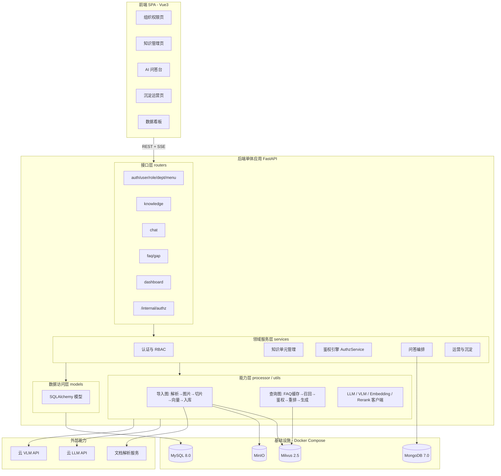
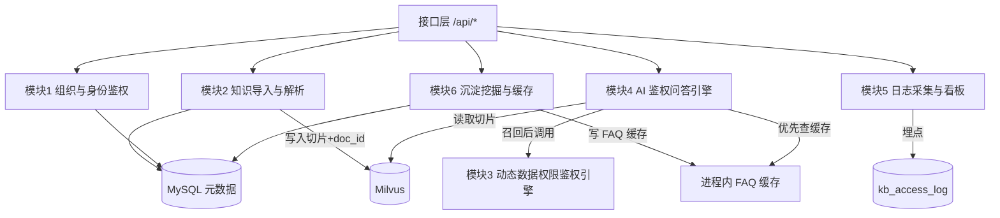
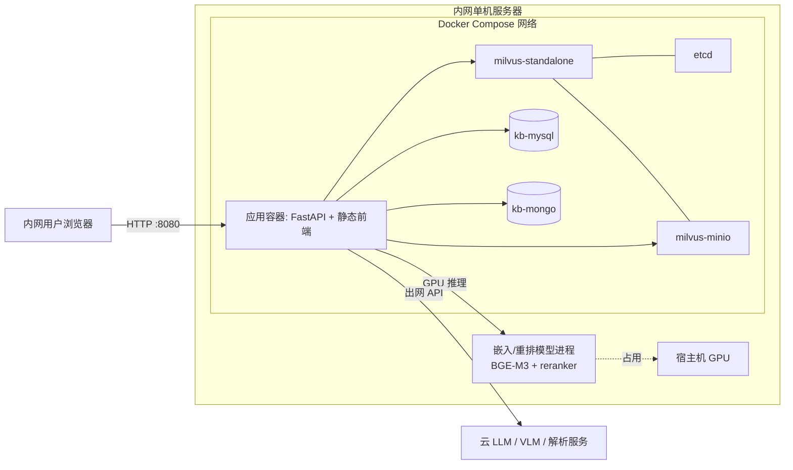
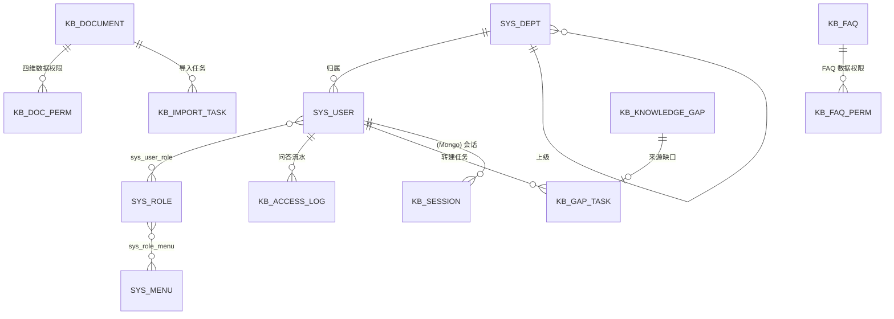
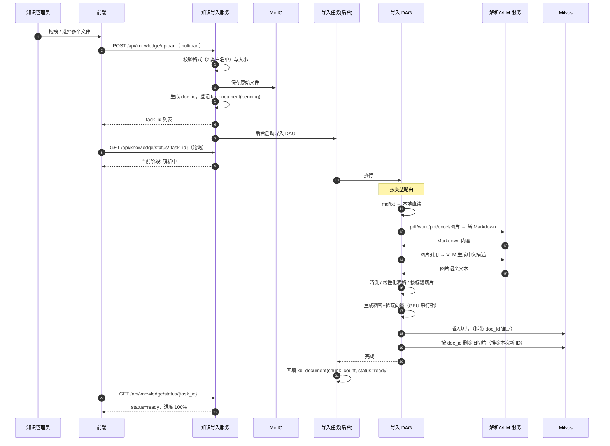
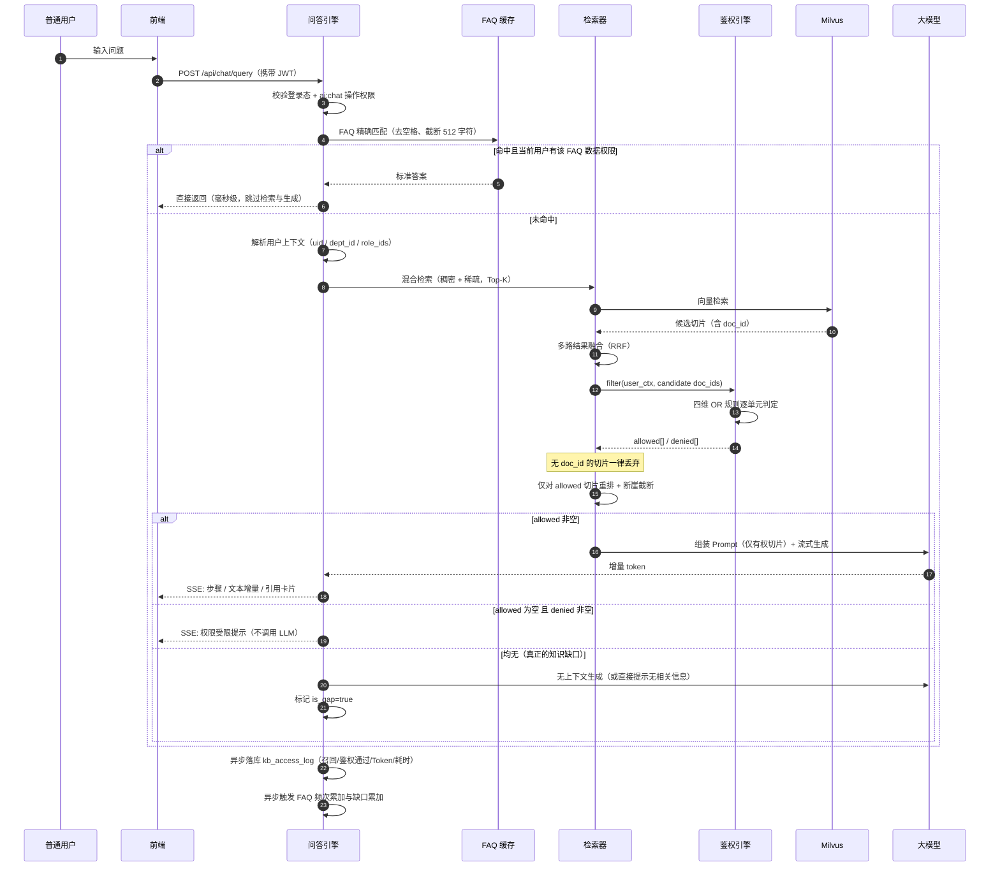
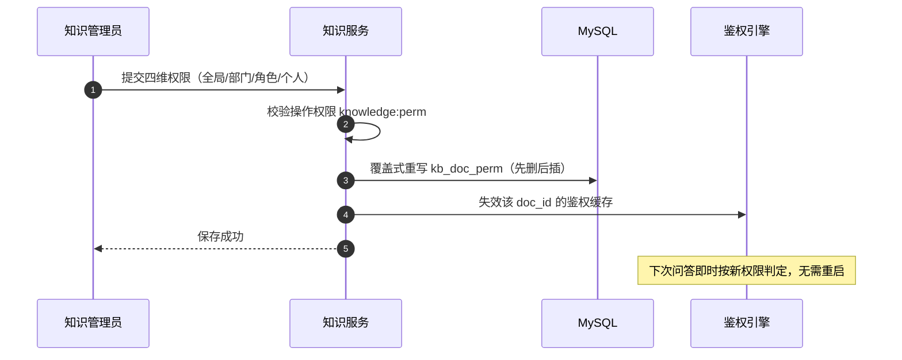

# 知识库管理平台 技术设计规格说明书（Design Spec）

> | 文档名称 | 技术设计规格说明书 |
> |----------|-------------------|
> | 版本 | v0.1 |
> | 架构师角色 | 系统架构师 |
> | 日期 | 2026-10-16 |
> | 状态 | 草稿（待架构评审） |
> | 依据 PRD | `docs/知识库管理平台PRD.md` v0.2（含决策 D1/D2/D3） |
> | 参考基线 | `F:\Download\5_杨涛\5.其他\晋海港_知识库平台`（同构实现「掌柜智库 ZGZK」，仅作选型与实现参考） |

**已锁定的三项技术约束**（2026-10-16 确认）

| 编号 | 约束 | 结论 |
|------|------|------|
| C1 | 技术栈 | 沿用参考基线全栈：Vue3 + Element Plus / Python FastAPI + LangGraph / MySQL + Milvus + MongoDB + MinIO |
| C2 | 部署与算力 | 内网单机 + GPU（嵌入 BGE-M3 与重排模型本地 GPU 部署，生成模型走云 API） |
| C3 | 架构风格 | 单体分层（Modular Monolith） |

**阅读约定**

- 每个设计章节末尾标注其覆盖的 PRD 功能编号（FR-xx），确保设计可回溯需求、P0 无遗漏。
- PRD 中标注 `[待确认]` 的项若影响设计，本文给出**默认取值的推荐方案**并显式标注 `[设计假设]`——它可运行，但不是需求结论，需评审确认。
- 数值指标凡 PRD 未给出者，本文只写设计手段，不编造目标值。

---

## 1. 架构设计概述

### 1.1 架构风格

**单体分层（Modular Monolith） + 前后端分离 + DAG 工作流编排**，三层组合：

- **部署形态**：单一后端应用进程，一个端口对外，同时托管前端静态产物（无需独立 Nginx）。
- **代码结构**：严格分层——接口层（routers）/ 领域服务层（services）/ 数据访问层（models + DAO）/ 能力层（processor、utils、prompts）。
- **流程编排**：导入链路与问答链路各由一条 LangGraph DAG 描述，节点即处理步骤，状态在节点间流转。



### 1.2 选型理由与权衡

| 选择 | 理由 | 放弃了什么 |
|------|------|-----------|
| **单体而非微服务** | RAG 链路内部调用极密集（一次问答 = FAQ 缓存 → 商品名确认 → 多路召回 → 融合 → 鉴权 → 重排 → 生成，7 个步骤），拆成服务会把进程内函数调用变成网络调用，延迟叠加且引入分布式一致性成本；本项目无独立扩缩容诉求 | 各模块无法独立扩容；单点故障影响全站（以容器重启策略 + 无状态设计缓解） |
| **严格分层而非"routers 里写业务"** | 鉴权规则、权限判定、检索策略必须被多处复用（如鉴权引擎同时被问答链路与数据权限接口调用），集中在 services 层可保证唯一事实来源 | 增加了文件数量与一次跳转成本 |
| **LangGraph DAG 而非手写 if/else 链** | 导入与查询都是多分支、长耗时、带状态的流程；图结构天然支持"每步产出可观测""分支可短路""流式回传步骤进度"，且新增节点（如后续接入联网搜索）只需加边 | 引入框架学习成本；调试需理解图的状态传递 |
| **SSE 而非 WebSocket** | 问答是单向流式输出，SSE 基于 HTTP、无握手与心跳管理、断线重连简单、可穿透多数内网代理 | 不支持双向通信（本项目无此需求） |
| **鉴权放在召回之后（而非检索前过滤）** | 检索前按权限过滤需要把权限条件下推为向量库的标量过滤表达式，实现复杂且易漏；召回后逐单元鉴权，逻辑集中在一处、可被独立测试，且天然产出"被拦截"信息用于安全提示 | 召回数量有限时可能出现"有权切片被无权切片挤掉 Top-K"的情况（见 ADR-003 后果） |

**覆盖需求**：全部 P0 需求（FR-01~FR-55）。

---

## 2. 技术栈与依赖

### 2.1 技术栈

| 层 | 技术选型 | 版本约束 | 用途 | 状态 |
|----|---------|---------|------|------|
| 前端框架 | Vue 3 + Vite | 3.x / 5.x | SPA 应用与构建 | C1 既定 |
| 前端 UI | Element Plus | 2.x | 管理后台组件库 | C1 既定 |
| 前端状态/路由 | Pinia + Vue Router | — | 用户态、动态菜单与路由守卫 | C1 既定 |
| 前端图表 | ECharts | 5.x | 看板可视化 | C1 既定 |
| 前端 Markdown | markdown-it + highlight.js + DOMPurify | — | 流式回答渲染、代码高亮、XSS 净化 | C1 既定 |
| 后端框架 | Python + FastAPI | Python ≥ 3.12 | HTTP 接口、SSE、静态托管 | C1 既定 |
| 后端编排 | LangGraph | — | 导入图 / 查询图 DAG | C1 既定 |
| ORM | SQLAlchemy | 2.x | 关系库访问 | C1 既定 |
| 关系库 | MySQL | 8.0 | 用户/权限/知识元数据/看板/FAQ/缺口 | C1 既定 |
| 向量库 | Milvus | 2.5.x（standalone） | 切片稠密 + 稀疏向量混合检索 | C1 既定 |
| 文档库 | MongoDB | 7.0 | AI 会话与消息历史 | C1 既定 |
| 对象存储 | MinIO | — | 原始文档、文档内图片 | C1 既定 |
| 认证 | JWT（HS256） + bcrypt | — | 无状态登录态、密码哈希 | C1 既定 |
| 生成模型 | 云 LLM API（可插拔） | — | 答案生成、问题改写、商品名识别 | `[设计假设]` 具体厂商见 §11 |
| 视觉模型 | 云 VLM API（可插拔） | — | 图片知识语义化（决策 D1 必需） | `[设计假设]` |
| 嵌入 / 重排 | BGE-M3 + BGE-reranker（本地 GPU） | — | 稠密+稀疏向量、精排 | C2 既定 |
| 文档解析 | 文档解析服务（PDF/Word/PPT/Excel/图片 → Markdown） | — | 统一转为中间格式 | `[设计假设]` 云服务或本地库见 §11 |

### 2.2 第三方依赖

| 依赖 | 用途 | 引入状态 |
|------|------|---------|
| `python-jose` / `passlib[bcrypt]` | JWT 签发解析、密码哈希 | 本次引入（沿用参考基线） |
| `pymilvus` | 向量库读写 | 本次引入 |
| `pymongo` | 会话读写 | 本次引入 |
| `minio` (SDK) | 对象存储读写 | 本次引入 |
| `langgraph` | DAG 编排 | 本次引入 |
| `transformers` / `FlagEmbedding` | BGE 模型加载与推理 | 本次引入 |
| `pymupdf` 或同类本地解析库 | **TXT/Markdown 直读与轻量 PDF 兜底**（参考基线不支持 TXT，需自建） | 本次新增 |
| 图片 OCR 兜底库（如 `paddleocr` 或同类） | VLM 不可用时的图片文本提取降级路径 | `[设计假设]` 可选 |
| `apscheduler` 或轻量定时任务 | 沉淀挖掘周期性触发 | 本次引入 |

**覆盖需求**：FR-04（7 类格式）、FR-06（向量化）。

---

## 3. 模块 / 服务划分

### 3.1 后端模块（对应 PRD §2.9.6 的 6 个模块）



| 模块 | 职责（做什么） | 不做什么 | 覆盖 FR |
|------|--------------|---------|---------|
| **M1 组织与身份鉴权服务** | 登录认证、JWT 签发与解析、用户/角色/部门/菜单 CRUD、角色-菜单权限分配、操作权限校验依赖（`require_permission`） | 不处理知识数据的可见性（那是 M3 的职责）；不做业务数据权限判定 | FR-13~FR-20 |
| **M2 知识导入与解析服务** | 文件上传与格式校验、对象存储落地、导入任务登记、驱动导入 DAG（解析/图片理解/清洗/切片/向量化/入库）、知识单元元数据 CRUD、切片级联清理 | 不做检索、不做权限判定（只负责写入 `doc_id` 锚点） | FR-01~FR-12 |
| **M3 动态数据权限鉴权引擎** | 接收「用户上下文 + 候选单元 ID 列表」，按四维 OR 规则返回 allowed/denied 两组结果；提供内部鉴权接口 | 不发起检索、不生成回答、不知道业务语义；不写业务数据 | FR-24（决策引擎本体） |
| **M4 AI 鉴权问答引擎** | 会话管理、FAQ 缓存优先匹配、多轮上下文拼接、多路召回、调用 M3 过滤、重排、Prompt 编排、流式生成、引用溯源元数据组装、权限受限提示 | 不直接读写权限表（一律经 M3）；不做数据统计聚合 | FR-21~FR-32 |
| **M5 日志采集与看板服务** | 异步落库问答流水、聚合产出 PV/UV、TOP 榜、Token 趋势、延时统计 | 不参与在线问答链路的决策；失败不得影响问答 | FR-33~FR-42 |
| **M6 沉淀挖掘与缓存服务** | 高频问题聚类与频次聚合、候选 FAQ 生成、FAQ 审核流转、FAQ 缓存生命周期（加载/失效/命中）、知识缺口识别与清单维护、缺口转建任务 | 不参与在线检索排序；缓存未命中时不得阻塞正常问答 | FR-43~FR-53 |

**横切模块**：`common`（统一响应包装、异常处理器、错误码、结构化日志、配置中心）、`deps`（依赖注入：当前用户、权限校验、数据库会话）。

### 3.2 前端模块（对应 PRD §2.9.5 的 5 个模块）

| 模块 | 职责 | 覆盖 FR |
|------|------|---------|
| 组织与权限管理模块 | 部门树控件、用户列表、角色授权树、按钮级鉴权指令 `v-permission`、路由守卫 | FR-13~FR-20 |
| 知识管理与批量导入模块 | 拖拽解析、格式校验、上传进度监听、知识单元列表与编辑抽屉 | FR-01~FR-12 |
| 权限实体选择器 | 部门树多选 + 角色多选 + 人员搜索多选 + 全局开关的一体化弹窗组件（知识单元与 FAQ 复用） | FR-17、FR-49 |
| AI 对话交互引擎 | SSE 流式 Markdown 渲染、代码块复制、引用源定位、权限缺失占位卡片、多会话侧栏 | FR-21~FR-32 |
| 沉淀运营与看板模块 | FAQ 审核流转交互、知识缺口转建档、排行榜与 ECharts 图表 | FR-33~FR-53 |

**覆盖需求**：前端模块覆盖全部有 UI 的 P0 需求；`权限实体选择器` 被两处复用（知识单元 FR-17 与 FAQ FR-49），须做成独立组件。

---

## 4. 部署拓扑

### 4.1 生产（内网单机）



**部署要点**

1. **端口收敛**：仅应用端口（默认 8080）对内网开放；MySQL 3306、MongoDB 27017、Milvus 19530、MinIO 仅容器网络内可达，不映射宿主机（如需运维访问，另行开通跳板机）。
2. **对象存储复用**：Milvus 自带的 MinIO 与业务对象存储**复用同一实例、不同 bucket**（如 `milvus-bucket` 与 `kb-files`），减少一个中间件；若运维要求隔离，可拆为独立实例。
3. **GPU 模型位置**：嵌入与重排模型运行在**应用进程内**（同机加载权重，通过全局推理锁串行化），而非独立推理服务——见 ADR-007。
4. **前端产物**：构建后由 FastAPI 静态托管，不单独部署 Nginx。
5. **出网策略**：应用容器需能访问云 LLM / VLM / 解析服务；若内网禁出网，则模型与解析服务必须本地化（见 §11 Q3）。

### 4.2 环境差异

| 环境 | 依赖服务 | 模型 | 前端 | 数据 |
|------|---------|------|------|------|
| dev | Docker Compose（可只起 MySQL + Milvus） | 嵌入可 Mock（返回伪向量），LLM 可切假数据 | Vite dev server + 热更新 | 本地测试数据 |
| test | Docker Compose 全量 | 全量真实模型 | 构建产物托管 | 脱敏/小规模数据集 |
| prod | Docker Compose 全量 + 容器 restart 策略 | 全量真实模型 | 构建产物托管 | 正式数据 + 备份策略 |

**覆盖需求**：支撑 FR-07（进度可视化需长耗时后台任务）、全部非功能需求（§8）。

---

## 5. 数据模型

### 5.1 实体关系



### 5.2 关系库表设计（MySQL 8.0 / utf8mb4）

**权限域**

| 表 | 关键字段 | 约束 / 索引 |
|----|---------|------------|
| `sys_dept` | id, name, parent_id(0=根), order_no, enabled | idx(parent_id) |
| `sys_user` | id, username, password_hash, nickname, dept_id FK, is_super, enabled | uk(username), idx(dept_id) |
| `sys_role` | id, name, code, remark, enabled | uk(code) |
| `sys_menu` | id, name, parent_id, type(0目录/1菜单/2按钮), perm, path, component, icon, order_no, visible | idx(parent_id), idx(perm) |
| `sys_user_role` | user_id, role_id | pk(user_id, role_id), CASCADE |
| `sys_role_menu` | role_id, menu_id | pk(role_id, menu_id), CASCADE |

**知识域**

| 表 | 关键字段 | 约束 / 索引 |
|----|---------|------------|
| `kb_document` | id, **doc_id(uk, 权限锚点, uuid hex)**, title, file_title, source_type(pdf/word/md/txt/ppt/excel/image), item_name, category, minio_object, chunk_count, status(pending/ready/failed), enabled, task_id, uploader_id, remark, created_at, updated_at | uk(doc_id), idx(status), idx(category), idx(created_at) |
| `kb_doc_perm` | id, doc_id(idx), document_pk FK, perm_type(global/department/role/user), entity_id(部门/角色/用户ID；global 时为 0) | idx(doc_id), idx(perm_type, entity_id), FK CASCADE |
| `kb_import_task` | id, task_id(uk), doc_id, filename, source_type, stage, status, error_msg, created_at, finished_at | uk(task_id), idx(status) |

**运营与沉淀域**

| 表 | 关键字段 | 约束 / 索引 |
|----|---------|------------|
| `kb_access_log` | id, session_id, user_id, username, dept_id, question, hit(bool), recalled_doc_ids, authorized_doc_ids, prompt_tokens, completion_tokens, total_tokens, latency_ms, faq_hit(bool), is_gap(bool), created_at | idx(created_at), idx(user_id), idx(question(191))；**按决策 D3 不存 denied 明细** |
| `kb_faq` | id, question, answer, hit_count, status(pending/published/rejected), source(auto/manual), cluster_key, confidence, auditor_id, created_at, published_at | idx(status), idx(hit_count), idx(cluster_key) |
| `kb_faq_perm` | id, faq_id FK, perm_type, entity_id | idx(faq_id), FK CASCADE |
| `kb_knowledge_gap` | id, question, hit_count, dept_id, last_user_id, resolved, created_at | idx(question(191)), idx(resolved), idx(hit_count) |
| `kb_gap_task` | id, gap_id FK, title, status(open/processing/done), owner_id, created_at | `[设计假设]` PRD Q9 未定形态，此处取最小任务实体 |

**关键状态机**

```
知识单元:  pending ──成功──> ready
              └──失败──> failed（可重试，重试回到 pending）

FAQ:       pending ──发布──> published ──下架──> pending/rejected
              └──驳回──> rejected

导入任务:  pending ──> parsing ──> chunking ──> embedding ──> done
              └────────────错误────────────> failed

知识补偿任务: open ──> processing ──> done
```

### 5.3 向量库（Milvus）Collection 设计

| Collection | 字段 | 类型 / 索引 | 说明 |
|-----------|------|------------|------|
| `kb_chunks` | chunk_id | INT64, auto_id, PK | 切片主键 |
| | dense_vector | FLOAT_VECTOR(1024) + AUTOINDEX / COSINE | BGE-M3 稠密向量 |
| | sparse_vector | SPARSE_FLOAT_VECTOR + SPARSE_INVERTED_INDEX / IP | BGE-M3 稀疏向量（关键词语义） |
| | content, title, parent_title, file_title, item_name | VARCHAR | 标量字段，用于组装 Prompt 与展示 |
| | **doc_id** | VARCHAR（冗余存储） | **权限锚点**：所有切片必须带 doc_id，无此字段的切片在鉴权时一律拒绝 |
| `kb_item_name` | item_name, dense/sparse vector | 向量 | 用于商品/产品名对齐与检索范围收敛 |

> **写入幂等**：同一 `doc_id` 重新导入时，先插入新切片拿到主键，再按 `doc_id` 删除旧切片并排除本次新插入的主键，避免"先删后插"导致的中断空窗（沿用参考基线做法）。

### 5.4 文档库（MongoDB）

| 集合 | 文档结构 | 索引 |
|------|---------|------|
| `chat_session` | `{_id, session_id, user_id, title, messages:[{role, content, steps[], images[], refs[], created_at}], created_at, updated_at}` | idx(session_id), idx(user_id, updated_at) |

**覆盖需求**：FR-01（台账字段）、FR-06（锚点）、FR-09（级联删除）、FR-17（权限表）、FR-40（审计流水，D3 裁剪）、FR-42（缺口）、FR-45（FAQ 卡片）、FR-49（FAQ 权限）。

---

## 6. 关键接口定义

### 6.1 统一约定

**响应包装**（除 SSE 与文件流外，全部接口统一）：

```json
{ "code": 0, "message": "ok", "data": { } }
```

**错误码体系**（段位划分）

| 段位 | 类别 | 示例 |
|------|------|------|
| `0` | 成功 | — |
| `100xx` | 参数与校验 | 10001 参数缺失、10002 文件格式不支持、10003 文件超限 |
| `200xx` | 认证与权限 | 20001 未登录/凭证失效、20002 无操作权限、20003 无数据权限、20004 账号已禁用 |
| `300xx` | 业务规则 | 30001 知识单元不存在、30002 状态不允许该操作、30003 解析失败、30004 FAQ 已发布不可重复发布 |
| `400xx` | 依赖与系统 | 40001 模型服务不可用、40002 向量库不可用、40003 解析服务不可用、40004 对象存储不可用、50000 服务内部错误 |

**鉴权约定**：除 `/api/auth/login` 外，全部接口须携带 `Authorization: Bearer <token>`；SSE 接口同样校验（token 经查询参数或头传入 `[设计假设]`）。

### 6.2 核心接口清单（8 组）

| 编号 | 方法 | 路径 | 说明 | 权限点 | 覆盖 FR |
|------|------|------|------|--------|---------|
| API-01 | POST | `/api/auth/login` | 账号密码登录，返回 token 与用户信息（含角色、权限点、菜单树） | 公开 | FR-19 |
| API-02 | GET | `/api/auth/me` | 当前用户信息与权限点 | 登录即可 | FR-19 |
| API-03 | POST | `/api/knowledge/upload` | 上传单个/多个文档，返回 task_id | `knowledge:import` | FR-02/03 |
| API-04 | GET | `/api/knowledge/status/{task_id}` | 查询导入进度与阶段 | `knowledge:query` | FR-07 |
| API-05 | GET | `/api/knowledge/list` | 知识单元台账（分页、关键词、格式、分类、状态筛选，含权限摘要） | `knowledge:list` | FR-01 |
| API-06 | POST | `/api/knowledge/perms/assign` | 覆盖式分配四维数据权限（支持批量单元） | `knowledge:perm` | FR-17/18 |
| API-07 | POST | `/api/chat/query` | 发起问答，返回 task_id（生成过程经 SSE 推送） | `ai:chat` | FR-21~FR-27 |
| API-08 | GET | `/api/chat/stream/{task_id}` | SSE 流式获取步骤、增量文本、引用、受限提示 | `ai:chat` | FR-25/27/28 |
| API-09 | POST | `/internal/authz/filter` | **内部**数据权限鉴权：入参 user_id + doc_ids，出参 allowed/denied | 内部调用 | FR-24 |
| API-10 | GET | `/api/precipitation/faq/list` | 候选 FAQ 列表（状态筛选、频次排序） | `faq:list` | FR-44/45 |
| API-11 | PUT | `/api/precipitation/faq/{id}/audit` | 审核：发布（写入缓存）/ 驳回 | `faq:audit` | FR-46/47 |
| API-12 | GET | `/api/precipitation/gap/list` | 知识缺口清单（默认仅未解决，按频次倒序） | `gap:list` | FR-50/51 |
| API-13 | POST | `/api/precipitation/gap/{id}/task` | 缺口一键转建补充任务 | `gap:list` | FR-52 |
| API-14 | GET | `/api/dashboard/overview` | 看板总览（PV/UV/单元数/Token/延时/命中率） | `dashboard:view` | FR-33~38 |
| API-15 | GET | `/api/dashboard/top-questions` | 高频提问排行 | `dashboard:view` | FR-35 |
| API-16 | GET | `/api/dashboard/top-docs` | 热门知识单元排行 | `dashboard:view` | FR-36 |

> 完整接口（用户/角色/部门/菜单 CRUD、知识编辑删除、会话历史、FAQ 数据权限等）按同一风格展开，此处不逐一罗列。

### 6.3 OpenAPI 片段示例

```yaml
/api/chat/query:
  post:
    summary: 发起知识问答（鉴权检索）
    security: [{ bearerAuth: [] }]
    requestBody:
      required: true
      content:
        application/json:
          schema:
            type: object
            required: [question, session_id]
            properties:
              question:
                type: string
                maxLength: 1000
                description: 用户提问文本
              session_id:
                type: string
                description: 会话 ID；为空表示新建会话
              web_search_enabled:
                type: boolean
                default: false
                description: 是否启用联网搜索（PRD Q18 待确认，默认关闭）
    responses:
      '200':
        description: 返回任务 ID，生成过程经 SSE 推送
        content:
          application/json:
            schema:
              type: object
              properties:
                code: { type: integer, example: 0 }
                data:
                  type: object
                  properties:
                    task_id: { type: string }
                    session_id: { type: string }
                    faq_hit: { type: boolean, description: 是否命中 FAQ 缓存（毫秒级直出） }
      '200-cached':
        description: 命中 FAQ 缓存时，答案直接在响应体返回，无需建立 SSE
      '400':
        description: 参数错误 10001 / 问题超长
      '401':
        description: 未登录 20001
      '403':
        description: 无 AI 对话操作权限 20002
      '200-noauth':
        description: |
          所有召回切片均被数据权限拦截时，SSE 返回权限受限事件：
          {"event":"notice","data":{"type":"permission_denied","message":"检测到相关制度文档，但您当前所属部门/角色无权查阅该内容"}}
      '503':
        description: 模型服务不可用 40001（安全降级为可读错误，不放行未授权内容）
```

**覆盖需求**：FR-01、FR-02、FR-07、FR-17、FR-19、FR-21~FR-28、FR-44~FR-52、FR-33~FR-36。

---

## 7. 关键流程时序图

### 7.1 文档导入与向量化（含 7 类格式路由与图片语义化）



### 7.2 AI 鉴权检索问答（核心安全链路）



### 7.3 权限配置生效



**覆盖需求**：FR-02~FR-07、FR-13、FR-17、FR-21~FR-28、FR-43~FR-47、FR-50。

---

## 8. 非功能设计

> PRD §5 给出了指标类别但多数数值 `[待确认]`；本表左侧为**类别与已知约束**，右侧为**落地手段**（不编造数值）。

| 维度 | 约束（来自 PRD） | 设计手段 |
|------|----------------|---------|
| **安全 · 鉴权覆盖** | 进入 AI 上下文的切片 100% 经权限校验（FR-24/26） | ① 鉴权作为查询 DAG 的**独立节点**，位于融合之后、重排之前，无旁路代码路径；② 鉴权对象是「候选切片列表」而非「最终 Top-N」，保证未授权切片在进入重排前即被移除；③ 切片无 `doc_id` 时**默认拒绝**（fail-closed），防止历史脏数据绕权 |
| **安全 · 越权零泄漏**（M3 红线） | 未授权内容不得出现在回答/引用/图片中 | ① Prompt 组装只接受 `allowed` 集合；② 权限受限时**不调用 LLM**，直接返回固定提示，杜绝模型"猜出"内容；③ 引用溯源卡片的来源列表取自 `allowed` 集合；④ 图片出图仅限已确认产品的有权切片 |
| **安全 · 操作权限** | 菜单/按钮级控制（FR-16/20） | 后端 `require_permission` 依赖注入统一拦截（不依赖前端隐藏）；前端 `v-permission` 指令 + 路由守卫做展示层收敛；**以后端为准** |
| **安全 · 认证** | 登录态强制（FR-22） | JWT 无状态凭证（含 iat/exp，密钥经环境注入）；密码 bcrypt 加盐哈希；账号 `enabled=false` 时拒绝签发 |
| **安全 · 降级** | 鉴权异常不得放行（AC-14） | 鉴权引擎任何异常 → 返回"全部拒绝"；检索异常 → 无上下文；模型异常 → 返回可读错误（40001）而非空答案 |
| **安全 · 审计** | 问答留痕（FR-40，D3 裁剪） | 问答结束异步写入 `kb_access_log`（用户、部门、问题、召回集合、鉴权通过集合、Token、耗时、是否 FAQ 命中、是否缺口）；写日志失败仅记警告，不影响回答 |
| **安全 · 传输与密钥** | `[待确认]` | 密钥/令牌一律走环境变量注入，`.env` 不入库；日志脱敏（不打印 token、密码、模型密钥） |
| **性能 · 首次响应** | 流式逐 token 输出（FR-27） | SSE 分事件推送：先推「处理步骤」事件让用户感知进展，再推文本增量；`--no-buffer` 关闭中间层缓冲 |
| **性能 · FAQ 缓存** | 毫秒级直出（FR-47） | 已发布 FAQ 常驻**进程内内存字典**（`question_hash → answer`），发布/下架时增量更新；命中路径不含任何网络调用与向量计算（仅需一次 FAQ 数据权限判定，可一并缓存权限标记） |
| **性能 · 检索** | 召回质量与耗时 | Milvus 稠密 AUTOINDEX(COSINE) + 稀疏倒排索引；单次召回 limit 固定（参考基线 5）；多路结果 RRF 融合后取 Top 10 进入鉴权，避免鉴权集合膨胀 |
| **性能 · 重排成本** | 重排为 GPU 密集操作 | 仅对 `allowed` 切片重排；断崖截断（相邻分差/相对差阈值）压缩进入 Prompt 的条数，减少 LLM 输入 Token |
| **性能 · GPU 串行** | 单卡独占（C2） | 全局推理锁包裹嵌入与重排调用，导入与查询共用同一锁：**同一时刻仅一个推理任务**，避免显存溢出；代价是导入与查询互相排队（见 ADR-007） |
| **性能 · 导入异步** | 长耗时不得阻塞界面（FR-07） | 上传立即返回 task_id → 后台任务执行 DAG → 前端轮询/SSE 获取阶段；导入任务状态持久化，进程重启后可识别未完成任务 |
| **性能 · 图表与列表** | 看板与台账响应 | 看板聚合按天预聚合（`kb_access_log` 上建 `created_at` 索引，必要时增加按日汇总表）；台账分页 + 组合索引（status/category/created_at） |
| **高可用 · 无状态** | 便于重启恢复 | 应用层不保存会话状态（JWT + 数据库/缓存重建）；唯一进程内状态是 FAQ 缓存与 GPU 锁，启动时自动重建 |
| **高可用 · 故障恢复** | 单机部署 | 容器 `restart: unless-stopped`；MySQL/Mongo/向量数据落盘卷持久化；应用启动健康检查（`/healthz` 校验三库连通性） |
| **高可用 · 依赖降级** | 部分依赖不可用时系统仍可用 | 云模型不可用 → 问答返回明确错误码（40001），但**管理端功能不受影响**；VLM 不可用 → 图片解析失败仅使该文件失败，不阻断批次；解析服务不可用 → 文件标记 failed 可重试 |
| **可观测 · 日志** | 失败可定位 | 结构化日志（含 request_id、user_id、task_id、doc_id、阶段、耗时）；错误分级；敏感字段脱敏 |
| **可观测 · 埋点** | 看板数据来源 | 统一走 `kb_access_log`，看板全部指标由该表聚合派生，避免多处统计口径不一致 |
| **可观测 · 链路** | 问答全链路可追踪 | 一次问答贯穿同一 `task_id` 与 `session_id`：检索 → 鉴权 → 重排 → 生成各阶段耗时分别记录（为 PRD Q12 的"延时口径"提供数据基础） |
| **可维护性 · 参数可配置** | PRD §5 要求 | 检索 Top-K、切分长度阈值、FAQ 阈值、断崖截断阈值、上下文预算、模型参数全部走配置（环境变量/配置表），不得硬编码——参考基线中存在"配置项已定义但代码硬编码"的缺陷，本项目须规避 |

**覆盖需求**：PRD §5 全部条目 + AC-14。

---

## 9. 设计决策记录（ADR）

| 编号 | 决策 | 背景 / 选项 | 选择理由 | 后果 |
|------|------|------------|---------|------|
| **ADR-001** | 采用单体分层，而非微服务 | 选项：A 单体分层；B 双服务（平台 + RAG）；C 按 6 模块拆分微服务 | 一次问答内部有 7 个处理步骤，拆服务将进程内调用变为网络调用，延迟与故障面叠加；无独立扩缩容诉求；团队规模与交付周期不支持微服务治理成本 | 模块边界靠代码分层约束而非物理隔离，需靠评审防止"大泥球"演化；后续若 RAG 成为瓶颈，可沿 `processor` 包边界平滑拆出（见 ADR-007 演进路径） |
| **ADR-002** | 用 LangGraph 编排导入与查询两图 | 选项：A 手写链式函数调用；B LangGraph DAG；C 引入通用工作流引擎 | 两条链路均为多分支 + 长耗时 + 需流式回传中间状态；DAG 让"新增一路召回（如联网）"变成加边而非改主流程；节点级便于埋点与降级 | 引入框架依赖与状态模型学习成本；调试需理解图的状态传递；图节点内不宜写重业务逻辑（应下沉到 services） |
| **ADR-003** | 数据权限在**召回后**过滤，而非检索前下推过滤 | 选项：A 检索前把权限条件下推为向量库标量过滤；B 召回后逐单元鉴权 | 方案 A 需将"用户 → 可访问 doc_id 集合"下推为 Milvus 过滤表达式，构建复杂、易与权限变更不同步；方案 B 逻辑集中、可单测、天然产出被拦截信息用于安全提示；与参考基线一致 | **已知代价**：无权切片会占用 Top-K 名额，可能导致"有权但相关度略低"的切片被挤出。缓解手段：召回 limit 放大后再过滤；若该问题在实测中显著，可在检索阶段叠加 doc_id 预过滤作为一级剪枝（不替代最终鉴权） |
| **ADR-004** | 向量库选 Milvus，而非 pgvector / ES | 选项：A Milvus；B PostgreSQL + pgvector；C Elasticsearch 向量检索 | 需同时使用**稠密 + 稀疏混合向量**（中文关键词与语义兼顾），Milvus 原生支持 sparse 向量与混合检索；C1 约束已定 | 多一个中间件（含 etcd/minio 依赖），单机部署较重；运维需额外了解 Milvus |
| **ADR-005** | FAQ 用**精确匹配 + 内存缓存**，而非语义相似匹配 | 选项：A 问题字符串精确匹配（标准化后） + 进程内缓存；B 向量相似度阈值匹配 | 方案 A 命中即"人工审定过的标准答案"，答案质量可控、零算力成本、毫秒级；方案 B 存在"语义相近但问的不是一回事"的误答风险，且需额外算力 | 表述略有差异的同类问题不会命中缓存（如多了标点或换了语序）；取舍是**宁可未命中走完整链路，不可错答** |
| **ADR-006** | 图片知识经 VLM 转文本入库，而非多模态向量 | 选项：A VLM/OCR 生成中文描述后注入文本切片；B 图片直接做多模态向量、与文本向量同库检索 | 方案 A 复用既有文本检索链路，无需跨模态对齐；图片描述同时可被人读、可被检索；方案 B 需跨模态模型且效果调优成本高 | 图片信息经过一次"模型转述"，可能丢失视觉细节；答案中的图片展示需另行保留原图 URL 与切片的关联 |
| **ADR-007** | 嵌入/重排模型运行在应用进程内（GPU 全局锁串行），而非独立推理服务 | 选项：A 进程内加载 + 全局锁；B 独立模型推理服务（HTTP/gRPC） | 方案 A 部署最简单、无网络开销、与参考基线一致；方案 B 需额外服务编排、显存管理、健康检查 | **导入与查询会互相阻塞**（同一把锁）：大文件导入期间，问答请求需排队等待。已知代价，缓解与演进见下方"演进路径" |
| **ADR-008** | TXT 走本地直读，补齐参考基线缺口 | 参考基线的解析服务不支持 TXT，而 PRD 决策 D1 要求支持 | 直读实现成本极低、无外部依赖、无解析服务配额消耗 | TXT 无结构信息，切片只能按长度/空行切分，检索粒度弱于 Markdown（标题切分）；建议在文档首页引导用户优先使用 Markdown |
| **ADR-009** | 决策 D3：审计不落库鉴权拦截明细 | 要求文档 §2.9.8 要求记录"鉴权拦截列表"，用户决策裁剪 | 降低存储与写入成本；拦截信息仅用于当次回答的安全提示，事后审计价值被认为有限 | **潜在风险**：若发生"该看到却没看到 / 不该看到却看到了"的争议，将缺少明细证据。缓解：日志（非表）中保留当次请求的 denied 集合，可用于短期排障，但不作为长期审计数据 |

**ADR-007 的演进路径**（若并发压力显现）

1. 一级：将嵌入/重排拆为独立模型服务（保留同一 GPU），应用通过内部 HTTP 调用 → 应用可水平扩展。
2. 二级：查询与导入使用**两套模型实例**（或两卡）→ 解除互相阻塞。
3. 三级：模型服务多副本 + 队列（导入走批处理队列，查询走优先队列）→ 支持并发与优先级。

**覆盖需求**：PRD §12 决策 D1/D2/D3 的技术落地；FR-04、FR-06、FR-24、FR-44、FR-47、FR-50。

---

## 10. 任务分解清单

> 依赖列标注前置任务；「并行组」列相同字母表示可并行推进。

| 任务编号 | 模块 | 依赖 | 并行组 | 说明 | 覆盖 FR |
|---------|------|------|-------|------|---------|
| **阶段一：地基** |||||
| T-01 | 后端骨架 | 无 | A | FastAPI 应用、配置中心、统一响应/异常/错误码、结构化日志、健康检查 | 横切 |
| T-02 | 数据层 | T-01 | A | SQLAlchemy 模型（§5.2 全表）、建表脚本、种子数据（超管 + 菜单权限点） | FR-13~16 |
| T-03 | 基础设施 | 无 | A | docker-compose：MySQL/MongoDB/Milvus(etcd+minio)/对象存储桶初始化 | 横切 |
| T-04 | 前端骨架 | T-01 | A | Vue3 工程、路由、布局、Pinia 用户态、axios 拦截器、v-permission 指令 | FR-20 |
| **阶段二：组织与权限** |||||
| T-05 | 认证 | T-02 | B | 登录/JWT/bcrypt/当前用户接口；`get_current_user` 依赖 | FR-19 |
| T-06 | RBAC | T-05 | B | `require_permission` 守卫、权限点解析、菜单树裁剪接口 | FR-16/20 |
| T-07 | 组织 CRUD | T-05 | B | 部门树、用户、角色、菜单 CRUD 接口 | FR-13/14/15 |
| T-08 | 角色授权 | T-07 | C | 角色-菜单权限树分配接口 | FR-16 |
| T-09 | 前端登录与组织页 | T-04、T-06、T-07 | C | 登录页、部门/用户/角色管理页、权限分配树 | FR-13~16、FR-19、FR-20 |
| **阶段三：知识导入与解析（7 类格式）** |||||
| T-10 | 知识单元 CRUD | T-02 | D | 台账列表、编辑、删除（含级联清理）、启停用、格式配置接口 | FR-01、FR-08、FR-09、FR-11 |
| T-11 | 上传与任务登记 | T-10 | D | 多文件上传、格式白名单校验、对象存储落地、doc_id 生成、任务表登记 | FR-02、FR-03 |
| T-12 | 导入 DAG | T-11 | E | 图编排：类型路由（md/txt 直读 · pdf/word/ppt/excel/image 走解析）→ 图片 VLM 语义化 → 清洗 → 表格线性化 → 按标题切片 | FR-04、FR-05 |
| T-13 | 向量化与入库 | T-12、T-03 | E | BGE-M3 稠密+稀疏向量（GPU 锁）、Milvus 写入、doc_id 锚点、幂等重建 | FR-06 |
| T-14 | 导入进度 | T-11 | E | 任务阶段持久化与查询接口；失败可重试 | FR-07 |
| T-15 | 前端知识管理页 | T-04、T-10、T-14 | F | 台账表格、拖拽导入抽屉、进度展示、编辑/删除 | FR-01~FR-09 |
| **阶段四：鉴权引擎与问答** |||||
| T-16 | 鉴权引擎 | T-02 | G | `AuthzService`：四维 OR 判定、批量 doc 过滤、内部鉴权接口、fail-closed 降级 | FR-24 |
| T-17 | 四维权限配置 | T-16、T-10 | G | 权限查询/覆盖式分配接口（含批量赋权） | FR-17、FR-18 |
| T-18 | 权限实体选择器组件 | T-04 | G | 部门树多选 + 角色多选 + 人员远程搜索 + 全局开关；知识单元与 FAQ 复用 | FR-17、FR-49 |
| T-19 | 检索链路 | T-13 | H | 混合检索、多路召回、RRF 融合 | FR-23 |
| T-20 | 检索鉴权接入 | T-16、T-19 | H | 鉴权节点置于融合后、重排前；无锚点切片拒绝 | FR-24、FR-26 |
| T-21 | 重排与上下文组装 | T-20 | H | BGE-reranker（GPU 锁）、断崖截断、Prompt 预算裁剪 | FR-26 |
| T-22 | 流式生成与 SSE | T-21 | I | 生成器接入、SSE 事件协议、步骤事件、中断能力 | FR-27、FR-31 |
| T-23 | 引用溯源与受限提示 | T-22 | I | 引用卡片元数据、权限受限事件与固定文案 | FR-25、FR-28 |
| T-24 | 会话存储 | T-22 | I | MongoDB 会话/消息持久化、会话列表、历史加载、删除 | FR-21、FR-29 |
| T-25 | FAQ 缓存优先匹配 | T-16、T-22 | I | 问题标准化 + 精确匹配 + FAQ 数据权限校验 + 毫秒直出 | FR-47 |
| T-26 | 前端问答工作台 | T-04、T-22、T-24 | J | 对话 UI、流式 Markdown 渲染、代码高亮、引用卡片、常见问题、历史侧栏 | FR-21~FR-32 |
| **阶段五：运营看板** |||||
| T-27 | 问答埋点 | T-22 | K | 异步落库问答流水（召回/鉴权通过/Token/耗时/命中/缺口标记） | FR-40 |
| T-28 | 看板聚合接口 | T-27 | K | 总览、趋势、TOP 提问、TOP 知识；按日预聚合 | FR-33~FR-39、FR-42 |
| T-29 | 前端看板页 | T-04、T-28 | L | 指标卡 + ECharts 图表 + 排行榜 | FR-33~FR-39 |
| **阶段六：知识沉淀** |||||
| T-30 | 频次聚合与 FAQ 推荐 | T-27 | M | 问题标准化、频次累加、达阈值生成候选 FAQ（含置信度与关联知识） | FR-43、FR-44、FR-45 |
| T-31 | FAQ 审核与发布缓存 | T-30 | M | 审核流转、发布写入内存缓存、下架失效、已发布 FAQ 检索 | FR-46、FR-47、FR-48 |
| T-32 | 缺口识别与清单 | T-27 | N | 三条件判定（D2）、缺口累加、清单查询、标记解决 | FR-50、FR-51、FR-53 |
| T-33 | 缺口转建任务 | T-32 | N | 任务实体与接口（形态待 Q9 确认，先按最小实现） | FR-52 |
| T-34 | 前端沉淀页 | T-04、T-31、T-33 | O | FAQ 审核区、已发布区、缺口清单区 | FR-44~FR-53 |
| **阶段七：交付** |||||
| T-35 | 端到端联调 | 全部 | P | 两条演示场景（跨部门制度隔离 / FAQ 沉淀与缺口）全流程跑通 | AC-12 |
| T-36 | 验收用例自测 | T-35 | P | 对照 AC-01~AC-14 逐条验证，形成测试记录 | 全部 AC |
| T-37 | 安全加固与交付文档 | T-35 | P | 密钥轮换、CORS 收敛、`.env` 出库、部署手册、演示脚本 | 非功能 |

**关键路径**：T-01 → T-02 → T-10 → T-11 → T-12 → T-13 → T-19 → T-20 → T-21 → T-22 → T-27 → T-30/T-32 → T-35。
**最大并行度**：阶段二（B/C 组）与阶段三（D/E/F 组）在 T-04 完成后可并行；阶段五与阶段六可在 T-27 后并行。

---

## 11. 待明确事项

| 编号 | 问题 | 影响 | 建议确认方 |
|------|------|------|-----------|
| S1 | 生成模型（LLM）与视觉模型（VLM）的具体供应商与型号 | 决定 Prompt 编排、Token 计费、上下文窗口、并发限流策略 | 业务方 / IT |
| S2 | 文档解析能力采用云服务还是本地库 | 决定部署依赖、内网出网策略、解析质量与成本 | IT / 架构评审 |
| S3 | 内网是否允许应用出网访问云模型 | 若禁出网，则 S1/S2 必须全部本地化，架构需增加本地模型服务（ADR-007 一级演进提前实施） | IT / 安全合规 |
| S4 | GPU 规格（显存容量、卡数）与并发预期 | 决定 BGE-M3 + reranker 能否同卡共存、导入与查询的排队容忍度 | IT / 业务方 |
| S5 | 非功能数值目标（首字延迟、端到端 P95、并发数、知识库规模、单文件上限）——承接 PRD Q20 | 决定是否需引入队列、独立推理服务、分片策略 | 业务方 / 架构评审 |
| S6 | 认证方式：自建账号 or 对接 SSO/LDAP——承接 PRD Q17 | 决定是否需实现组织架构同步任务 | 业务方 / IT |
| S7 | 「所属分类」的数据模型（可维护分类树 vs 固定枚举）——承接 PRD Q3 | 决定是否需 `kb_category` 表与级联筛选 | 业务方 |
| S8 | 「切片调整」的交互粒度——承接 PRD Q4 | 若需编辑切片内容，则需设计切片级写回向量库的流程（当前设计仅支持单元级重建） | 业务方 |
| S9 | 知识缺口转建任务的形态（Q9）与是否保留「最高相似度得分」字段（Q23） | 影响 `kb_gap_task` 与 `kb_knowledge_gap` 表结构 | 业务方 |
| S10 | FAQ 数据权限默认语义（Q8：未配置=公开 or 拒绝） | 影响 `filter_faq_ids` 的 fail-open / fail-closed 实现 | 业务方 |
| S11 | 是否需要独立的「审计/合规」角色与审计查询页（Q14/Q41） | 影响权限点与看板扩展 | 业务方 / 合规 |
| S12 | 是否启用联网搜索（Q18）与 RAG 评测（Q19） | 联网搜索需在查询图中加一路召回；评测需额外交付 `eval/` 工具 | 需求提出方 |

---

## 附录：质量自检（Quality Gate）

| 检查项 | 结论 |
|--------|------|
| 架构风格已定 | 通过——§1.1 明确单体分层，§1.2 逐项给出选型理由与被放弃的选项 |
| 模块边界清晰 | 通过——§3.1 六大后端模块 + 横切层，职责表含「不做什么」；§3.2 前端五模块；与 PRD §2.9.5/2.9.6 一一对应 |
| PRD 功能全覆盖 | 通过——§3 职责表与 §10 任务表均回溯 FR 编号；FR-01~FR-55 全部落位 |
| 接口有契约 | 通过——§6 含统一响应、五段错误码体系、16 组核心接口与权限点，并附 OpenAPI 片段（含 SSE 与受限提示分支） |
| 数据模型一致 | 通过——§5 与 PRD §8 实体对齐并细化到字段、索引、约束、状态机；新增 `kb_import_task`、`kb_gap_task` 两张 PRD 未显式定义的支撑表并说明来源 |
| 非功能有手段 | 通过——§8 每项均给设计手段，未复述指标；PRD 未定量的部分只写手段不编数值 |
| 关键流程有时序 | 通过——§7 三条 sequence：导入（含 7 类格式与图片语义化）、鉴权问答（含三种分支）、权限生效 |
| 重大选型有 ADR | 通过——ADR-001~ADR-009，含已知代价与演进路径（ADR-007） |
| 任务可编排 | 通过——T-01~T-37，标注依赖与并行组，给出关键路径 |
| 无臆造约束 | 通过——C1/C2/C3 为用户确认结果；其余技术选择标注 `[设计假设]` 并列入 §11 待确认 |
| 决策已落地 | 通过——D1（T-12 格式路由）· D2（T-32 三条件判定）· D3（T-27 不含拦截明细）均有对应任务 |
